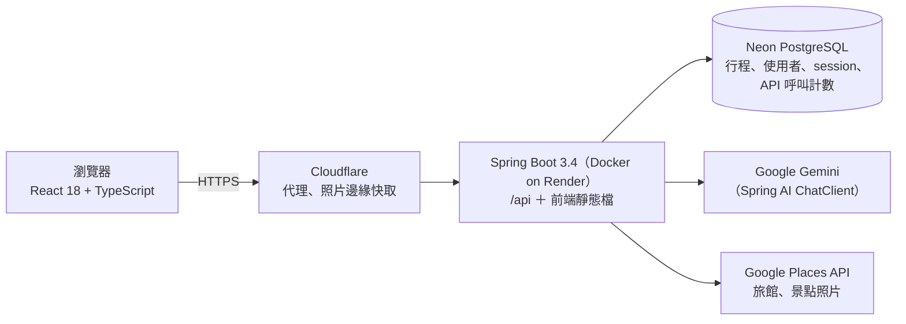

# TravelPlanner — AI 旅遊行程規劃

> 這是展示用的程式碼快照。完整開發歷史（2026 年 4 月起 166 個 commit）在私人 repo，面試時可以現場展示。

用一句話描述想怎麼玩，產生逐日行程，並附上 Google Places 查到的**真實旅館**。

**正式站：https://travel-planner.gary-coding.com**

可以試試輸入：「台中兩天一夜，開車，想去老街和咖啡廳，不要太趕」

> 部署在免費方案：閒置 15 分鐘後伺服器會休眠，第一次開啟要等約 2–3 分鐘喚醒（頁面會顯示提示）。如果第一次生成請你稍後再試，等一下再按一次就好。

個人業餘專案，2026 年 4 月開始，一個人從零做到上線；目前有 4 位朋友實際試用，依他們的 21 則回饋持續修改。
這個專案的重點在後端：架構與取捨由我設計；前端大部分由 AI 協助產出，我負責整合與驗證。

## 功能

- 自然語言產生多日行程：景點、時間、交通方式（開車／大眾運輸／步行）
- 每天附上真實旅館（Google Places 查詢；最後一天不用住）
- 拖曳調整景點順序，時間自動重新排
- 儲存行程、產生唯讀的分享連結
- Google 登入、「我的行程」
- 行前清單、深色模式

## 技術

| 類別 | 使用技術 |
|---|---|
| 後端 | Java 17、Spring Boot 3.4、Spring AI 1.1（Google Gemini）、Spring Security 6、Spring Session JDBC、Spring Data JPA、Bucket4j、Caffeine、Apache HttpClient 5 |
| 資料庫 | PostgreSQL（Neon）；本機與測試用 H2 |
| 前端 | React 18、TypeScript、Vite、Tailwind CSS v4 |
| 測試 | JUnit 5、Mockito、`@WebMvcTest`、`@DataJpaTest`、Playwright |
| 部署 | Docker（三階段 build）、Render、Cloudflare、GitHub Actions |

## 架構



單一 Spring Boot 服務（modular monolith，分 `attraction`／`user`／`shared` 三個模組），一個 jar 同時服務 `/api` 和 React 前端。

```
backend/    Spring Boot（com.travel.app.attraction／user／shared）
frontend/   React + TypeScript（Vite）；e2e/ 是 Playwright 測試
Dockerfile  三階段 build：Node 建前端 → Maven 建後端 → 只帶 JRE 與 jar
```

### 一次「生成行程」請求經過的關卡（`POST /api/itinerary/generate`）

1. 前端先輪詢 `/api/health`，確認伺服器醒著才送出（原因見下方「冷啟動」）
2. per-IP 限流 → 全站每日上限
3. 組 prompt（附 JSON schema）→ 扣 Gemini 呼叫計數 → 呼叫 Gemini（60 秒 timeout）→ 解析成 `RawTripPlan`；呼叫或解析失敗就自動重試一次
4. 逐日並行查 Google Places 旅館，每次呼叫前先扣 Places 計數
5. 對完整的 `TripPlan` 跑一次契約驗證，回傳

## 後端設計重點

### 1. 免費額度防線：一層一層加上去

Gemini 和 Google Places 都按呼叫次數算額度，Places 超過免費次數還會直接收費——額度就是這個專案的生存線。

- **per-IP 限流**（Bucket4j token bucket）：依端點成本分四級，`/generate` 最嚴；超過回 429 並帶 `Retry-After`。存 bucket 的 map 用 Caffeine 做閒置驅逐，避免限流器本身被大量 IP 撐爆記憶體。
- **取得真實的 client IP**：`X-Forwarded-For` 從右往左跳過已知的代理段數（最左邊是客戶端自己填的，可以偽造），段數依實際部署拓樸（Cloudflare → Render）設定。
- **全站每日上限**：只掛在 `/generate`，而且刻意排在 per-IP 限流之後——順序反過來的話，被 per-IP 擋下的請求也會先扣掉全站額度，一個人就能把全站額度用光。
- **對外呼叫計數存在資料庫**（`PersistentCallCounter`）：Gemini 按日、Places 的四個呼叫點各自按月計數。免費方案的伺服器閒置就會休眠，記憶體裡的計數醒來就歸零，所以存資料庫。
  - 「檢查上限」和「加一」放在同一句 SQL：`UPDATE … SET used_count = used_count + 1 WHERE … AND used_count < :max`。同一列的 UPDATE 由列鎖排隊，PostgreSQL 在 READ COMMITTED 下會用最新的值重新檢查 WHERE，所以設計上多個請求、甚至多個 JVM 同時搶也不會超發。
  - 刻意不用 JPA 的 `save()`：主鍵是自己指定的，`save()` 會走 merge（先查再寫），並發時可能蓋掉別人剛加上去的次數。
  - 換日、換月對齊 Google 重置額度的時間（太平洋時間）；注入 `Clock`，測試可以把時間推過午夜。
  - 資料庫故障時依成本決定：Places（超過會收費）擋下；Gemini（免費方案，超過只會被拒絕）放行。

程式：[`PersistentCallCounter`](backend/src/main/java/com/travel/app/shared/quota/PersistentCallCounter.java)、[`ApiCallCounterRepository`](backend/src/main/java/com/travel/app/shared/quota/ApiCallCounterRepository.java)、[`RateLimitInterceptor`](backend/src/main/java/com/travel/app/shared/config/RateLimitInterceptor.java)、[`DailyQuotaInterceptor`](backend/src/main/java/com/travel/app/shared/config/DailyQuotaInterceptor.java)、[`WebConfig`](backend/src/main/java/com/travel/app/shared/config/WebConfig.java)

### 2. 把 LLM 當成不可信的上游服務

LLM 的輸出格式會亂、內容會幻覺，偶爾還會很慢或失敗。

- **結構化輸出**：Spring AI 的 `BeanOutputConverter<RawTripPlan>` 把 JSON schema 放進 prompt；回應先剝掉 code fence、截出最外層的 JSON，再轉成 DTO。
- **用 DTO 邊界防幻覺**：交給 AI 填的 `RawTripPlan` 根本沒有旅館欄位，AI 沒有機會編造旅館或評分；真實旅館由 Google Places 查回來之後，才組進對外的 `TripPlan`。
- **生成當下就跑契約驗證**：用 Bean Validation 對完整的 `TripPlan` 驗一次（跟儲存 API 同一份規格），避免「生成看起來成功，按儲存才被退回」。
- **只重試該重試的**：自動重試一次，範圍只有「呼叫＋解析」，不會重打 Places；額度用完的例外直接穿過重試。
- **自己包 timeout**：Spring AI 1.1.0 的 Google GenAI 沒辦法從設定檔設 HTTP timeout，所以在外層用 `CompletableFuture.orTimeout(60s)`。
- **錯誤碼**：`AI_TIMEOUT`／`AI_ERROR`／`AI_PARSE_ERROR` 放在回應 body，前端依此顯示不同的文案。

程式：[`GeminiItineraryService`](backend/src/main/java/com/travel/app/attraction/service/GeminiItineraryService.java)、[`RawTripPlan`](backend/src/main/java/com/travel/app/attraction/dto/RawTripPlan.java)、[`GlobalExceptionHandler`](backend/src/main/java/com/travel/app/shared/exception/GlobalExceptionHandler.java)

### 3. 外部服務一定會失敗：降級與失敗隔離

- **逐日並行查旅館**：每天一個 `CompletableFuture`，跑在專用、有上限的執行緒池（查旅館是 blocking IO，不丟給預設的 async pool），每天各自 10 秒 timeout；刻意不用 `allOf`，某一天失敗只影響那一天。
- **Places 查不到時降級**：讀 Google 回應 body 裡的 `status`，錯誤就丟例外——失敗的空結果不會被快取，額度恢復後就查得到；行程照樣產生，只有那一天的旅館區顯示提示。
- **冷啟動 × Cloudflare 的 100 秒上限**：免費方案冷啟動約 2–3 分鐘，加上 AI 生成 20–60 秒，同一個請求一定會超過 Cloudflare 等待回應的上限（100 秒，免費方案不能調）。解法是改變請求的形狀：前端先用一連串短探測輪詢 `/api/health` 把伺服器叫醒，醒了才送出生成請求。
- **景點照片**：由後端 proxy Google 的照片，兩層快取（Caffeine → 資料庫存 `photo_reference` 30 天），再加上 Cloudflare 邊緣快取；同一個景點的並發查詢用 single-flight（`ConcurrentHashMap` ＋ `CompletableFuture`）合併成一次。

程式：[`GeminiItineraryService`](backend/src/main/java/com/travel/app/attraction/service/GeminiItineraryService.java)（`enrichWithHotels()`）、[`AsyncConfig`](backend/src/main/java/com/travel/app/shared/config/AsyncConfig.java)、[`HotelServiceImpl`](backend/src/main/java/com/travel/app/attraction/service/HotelServiceImpl.java)、[`PlaceServiceImpl`](backend/src/main/java/com/travel/app/attraction/service/PlaceServiceImpl.java)、[`useServerWakeup.ts`](frontend/src/useServerWakeup.ts)

### 4. 登入與安全

- **Google 登入**：後端驗證 ID token（簽章、iss、aud、exp）；session 用 Spring Session JDBC 存在資料庫（14 天），重新部署也不會掉登入。
- **CSRF**：double-submit cookie。Spring Security 6 預設延遲產生 token，所以加一個 filter 讓它立即產生，SPA 的第一個請求才拿得到 cookie；連登入端點也要 CSRF token，防 login CSRF。
- **Session fixation**：自己建立 SecurityContext 不會觸發 Spring Security 內建的保護，所以登入時手動呼叫 `changeSessionId()`。
- **分享連結的刪除 token**：只在建立時回傳一次明文，資料庫只存 SHA-256。

程式：[`SecurityConfig`](backend/src/main/java/com/travel/app/shared/config/SecurityConfig.java)、[`AuthController`](backend/src/main/java/com/travel/app/user/controller/AuthController.java)、[`GoogleIdTokenVerifierService`](backend/src/main/java/com/travel/app/user/service/GoogleIdTokenVerifierService.java)

### 5. 從事故學到的：啟動防呆與錯誤可視化

- **啟動期 fail-fast**：曾經遇過平台回收資料庫、`ddl-auto` 吃到預設的 `create-drop`、H2 console 對外開著，表面上卻只像「冷啟動比較慢」。之後加了三個啟動檢查，正式環境遇到危險的設定組合就直接讓 Spring 起不來——寧可部署失敗，也不要帶病上線。
- **前端崩潰回報**：兩層 ErrorBoundary（結果區壞了，輸入區還能用）＋ `POST /api/client-error` 把崩潰資訊送進後端 log。加上之後隔天就從 log 定位到白畫面的根因並修掉：後端契約允許某個欄位不給，前端的型別卻假設它一定有。

程式：[`DatabaseSafetyCheck`](backend/src/main/java/com/travel/app/shared/config/DatabaseSafetyCheck.java)、[`H2ConsoleSafetyCheck`](backend/src/main/java/com/travel/app/shared/config/H2ConsoleSafetyCheck.java)、[`AuthStartupCheck`](backend/src/main/java/com/travel/app/shared/config/AuthStartupCheck.java)、[`ClientErrorController`](backend/src/main/java/com/travel/app/shared/observability/ClientErrorController.java)、[`ErrorBoundary.tsx`](frontend/src/components/ErrorBoundary.tsx)

## 測試與 CI

- 後端 159 個測試（21 個測試類別），GitHub Actions 每次 push 都會跑；不需要任何 API key，也不會打到真的 Google API。
  - 單元測試注入 `Clock`，驗證換日、換月
  - 用 mock 的 HTTP client 數「打出去幾次」；被擋下時用 `verifyNoInteractions` 證明真的沒有發出連線
  - `@WebMvcTest` 走真的 filter chain 與攔截器，測 CSRF、401 和攔截器有沒有接上
  - `@DataJpaTest` 測計數器的 SQL
- 前端 Playwright E2E 共 14 個情境，用 `page.route()` 把後端全部 mock 掉、不花 API 額度（目前手動執行，還沒進 CI）。

## 本機執行

需要 JDK 17、Maven、Node 20，以及 Google 的 API key（Gemini 與 Places 各一）。

```bash
# 後端：http://localhost:8080（本機預設用 H2 in-memory 資料庫）
cd backend
export GOOGLE_API_KEY=<Gemini API key>
export GOOGLE_MAPS_API_KEY=<Google Maps Places API key>
mvn spring-boot:run

# 前端：http://localhost:5173（/api 會 proxy 到 :8080）
cd frontend
npm install
npm run dev
```

- 不設 `GOOGLE_OAUTH_CLIENT_ID` 時，Google 登入會停用，其他功能照常。
- 跑測試：`cd backend && mvn test`；`cd frontend && npm run test:e2e`。

## 已知限制與下一步

- **計數器還沒有並發測試**：「不會超發」目前靠上面那段資料庫語意的設計論證；`@DataJpaTest` 跑在 H2，測的是邏輯不是鎖。下一步用 Testcontainers 起真的 PostgreSQL、開多條執行緒同時搶，驗證放行數剛好等於上限。
- **AI 輸出只驗格式與契約**：還沒有語意驗證（天數是否符合需求、時間是否遞增、輸入是不是旅遊需求）；下一步加上語意驗證和固定 prompt 的回歸基準。
- **逾時預算沒有端到端對齊**：Gemini 60 秒加上重試一次，最壞約 120 秒，超過前端的 95 秒和 Cloudflare 的 100 秒；應該傳遞剩餘時間（deadline），不夠就不重試。
- **`/generate` 是同步的長請求**：規模變大要改成非同步（202 ＋ jobId 輪詢）；伺服器整台在睡的時候，第一次開頁仍可能遇到 Cloudflare 524。
